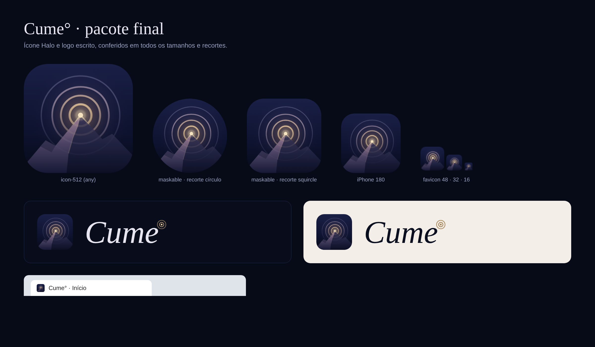

<p align="center"></p>

# Cume° · Personal Life OS

**Foco · Clareza · Ação**

PWA (instalável e offline) feito a partir do `MeuPlano_Design_v6.pdf` e da v7 (`docs/v7/`).
Identidade visual em `docs/brand/` (guia `Cume_Guia_de_Identidade.pdf`).

<p align="center"></p>

| Amanhecer · 05h–10h | Dia · 10h–16h | Entardecer · 16h–19h | Noite · 19h–05h |
| --- | --- | --- | --- |
|  |  |  |  |

O cenário do topo e do login muda pelo horário (`src/lib/scene.ts`) ou fica fixo em Personalizar → Cenário.

> **Nomes históricos que não mudam:** o banco IndexedDB `meuplano`, as chaves `meuplano.*` do localStorage,
> o formato `meuplano-backup` e o endereço `meuplano-rouge.vercel.app`. Os dados ficam no navegador,
> e cada endereço tem um armazenamento separado: trocar o nome ou o endereço esconderia os dados.

## Rodar

```sh
pnpm install
pnpm dev        # http://localhost:5173
pnpm build      # gera dist/ com service worker
pnpm preview    # testa o build (instalação e offline)
```

## Publicação

No ar em https://meuplano-rouge.vercel.app (Vercel). Cada push na branch `main` do GitHub publica sozinho.

## Telas

Login com o cenário do horário · Início · Minha semana · Agenda · Tarefas · Planejamento · Calendário ·
Objetivos e Metas · Imprevistos · painéis das 6 áreas · Cofre de documentos · Personalizar.

## Recursos novos (além do design)

- **Imprevistos recorrentes** (`src/lib/recurrence.ts`): imprevistos parecidos da mesma área são
  agrupados; quando um grupo aparece N vezes em 30 dias (padrão 3, ajustável), o app sugere
  reservar um bloco fixo no planejamento (dia da semana mais comum, horário típico, duração média).
  A sugestão aparece na Início, em Imprevistos, no Planejamento e no sino; aceitar cria um bloco
  semanal listrado na Agenda; "Agora não" silencia por 30 dias.
- **Link do Google Drive no Cofre**: além de enviar arquivo, dá para guardar o link de um documento
  do Drive (validado para `drive.google.com` / `docs.google.com`).

## Dados (regras que não podem ser quebradas)

- Tudo fica no IndexedDB (Dexie, `src/lib/db.ts`). Arquivos: binário em `blobs`, metadados em `attachments`
  (`src/lib/attachments.ts`). Nunca em memória nem em `localStorage`; URLs de arquivo são criadas na hora de exibir.
- **Schema versionado**: toda mudança de estrutura = nova `db.version(n)` com `.upgrade()` que transforma os dados.
  Proibido apagar/recriar o banco. Os testes em `tests/unit/migration.test.ts` provam isso.
- **Exclusão** = soft delete (`deletedAt`) + "Desfazer" (6 s) + Lixeira de 30 dias (`src/lib/trash.ts`).
- **Formulários**: rascunho (novo) ou autosave (edição) com debounce, "salvo às HH:MM" (`src/lib/drafts.ts`).
- **Service worker** em modo `prompt`: só limpa caches de assets antigos; mostra "Nova versão disponível · Atualizar".
- **Backup** `.zip` (JSON + arquivos) em Configurações; importar soma, nunca apaga (`src/lib/backup.ts`).
- Dados de exemplo só entram com o banco vazio.

## Testes

```sh
pnpm test        # Vitest + fake-indexeddb: migração, lixeira, backup, seed
pnpm test:e2e    # Playwright com o Chrome instalado: recarregar, troca de versão do SW, reabrir o app, layout 360/768/1280
```
