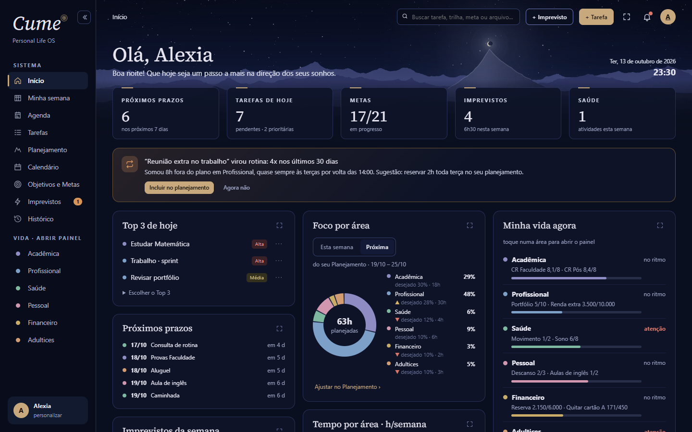
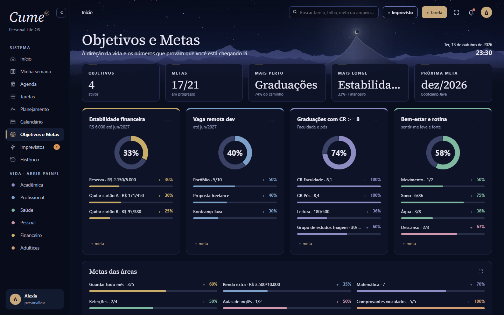

<p align="center"></p>

<h1 align="center">Cume°</h1>

<p align="center">
  A personal planning app that turns life goals into measurable targets and daily tasks.<br />
  Installable, works offline, syncs across devices.
</p>

<p align="center">
  <a href="https://meuplano-rouge.vercel.app"><b>▶ Live app</b></a> ·
  <a href="https://github.com/AlexiaSPaiva/cume/actions/workflows/ci.yml"></a>
</p>

<p align="center"></p>

## The problem

I wanted one place to go from *"where do I want to be"* to *"what do I do today"*, across studies, work, health and
money, and to see when unplanned events were eating my week. Planners I tried kept these apart, so I designed
and built my own.

Cume° is built around three ideas:

| | What it is | Example |
| --- | --- | --- |
| **Objective** | where you want to get | pass a public exam |
| **Goal** | a measurable step, with a number and a deadline | study 200 h by March |
| **Task** | what to do today | 20 practice questions at 7 pm |

Finishing tasks moves goals forward, and goals move objectives forward. Progress is derived from the data,
never typed in by hand.

## Features

- **Weekly planning** by hours available per life area, with a weekly and daily Top 3.
- **Agenda, week view and calendar** with fixed blocks, rest blocks and unplanned events side by side.
- **Unplanned events log**: when the same interruption repeats (e.g. 3× in 30 days), the app suggests reserving time for it.
- **Goals measured by tasks or by value**, including recurring weekly tasks and study tracks.
- **Study tracks** (exam prep, courses, research) with schedules, spaced reviews and a Pomodoro timer.
- **Postponed tasks and trash**: nothing is lost; tasks can be rescheduled without being recreated, deletes can be undone.
- **History** comparing day / week / month / year against the previous period.
- **Document vault** for files and Google Drive links, plus a `.zip` backup.
- **Animated onboarding tour** with generated background music (Web Audio, no audio files).

<p align="center">
  
  
</p>

## Tech stack

| Area | Choices |
| --- | --- |
| Front end | React 19, TypeScript, Vite, React Router, CSS (no UI kit) |
| Offline & PWA | IndexedDB via Dexie, `vite-plugin-pwa` (Workbox), installable on iOS and Android |
| Back end | Supabase: Postgres with Row Level Security, Auth, private Storage bucket |
| Testing | Vitest + fake-indexeddb (unit), Playwright on Chrome and WebKit/iPhone (end to end) |
| Delivery | GitHub Actions CI, continuous deployment on Vercel |

## Architecture

```
 ┌──────────── device (works offline) ────────────┐          ┌──────── Supabase ────────┐
 │ React UI ──► Dexie / IndexedDB (source of truth)│  sync    │ Postgres `rows` table    │
 │                │                               │ ◄──────► │ RLS: each user sees only │
 │                └─ pending-changes queue ────────┤          │ their own rows           │
 │ Service worker: app shell cached, update banner │          │ Storage: private files   │
 └────────────────────────────────────────────────┘          └──────────────────────────┘
```

- **Local-first.** Every read and write hits IndexedDB, so the app is instant and fully usable offline.
- **Sync engine** (`src/lib/sync.ts`): pushes queued local changes, pulls remote changes, and resolves conflicts
  per record with last-write-wins on `updatedAt`. IDs are unique across devices; colliding legacy IDs are
  renumbered with their references fixed.
- **Versioned schema** (`src/lib/db.ts`): migrations only add tables, never drop data. A test suite proves that
  data from every previous version survives an upgrade.
- **Soft delete** with a 6-second undo and a 30-day trash.
- Database schema and policies: [`supabase/schema.sql`](supabase/schema.sql).

## Engineering notes

- **A layout bug only on older iPhones.** On iOS < 16.4 the phone showed the desktop layout squeezed. The cause:
  Vite emitted media queries in range syntax (`@media (width <= 767px)`), which Safari 14–16.3 ignores. Fixed by
  setting explicit build targets and adding fallbacks for `color-mix()`, plus a test that keeps it from coming back.
  Modern WebKit in Playwright did not catch it, which is why there is now a compatibility test.
- **Opening PDFs on iOS.** `window.open` after an `await` is blocked by Safari, so files now open in an in-app
  viewer with signed URLs, and there is a fallback for when Safari refuses to store a `Blob` in IndexedDB.
- **Updates without losing work.** A new version waits until the app is reopened or left, so drafts are never
  interrupted.

## Tests

```sh
pnpm test        # unit: migrations, sync, trash, backup, recurrence, goal progress…
pnpm test:e2e    # end to end: Chrome (flows, 360–1280 px layouts) and WebKit (320–430 px iPhones)
```

Around 80 unit tests and 50+ end-to-end tests run on every push in GitHub Actions.

## Run locally

```sh
pnpm install
pnpm dev          # http://localhost:5173  (add /?exemplos=1 for sample data)
```

Without Supabase variables the app runs local-only. To enable sync, copy your project's URL and public key into
`.env.local` as `VITE_SUPABASE_URL` and `VITE_SUPABASE_ANON_KEY`, and apply `supabase/schema.sql`.

## How it was built

I came up with the product, designed the screens and wrote the specification (features, data rules, what must
never break), then built it iteratively. I used Claude Code as an AI coding assistant for implementation and
refactoring; commits where it helped are marked `Co-Authored-By`. The product, the decisions between the technical
options on the table, review and testing on real devices were mine.

The interface is in Portuguese (Brazil). Detailed development notes, also in Portuguese:
[`docs/DEVELOPMENT.pt-BR.md`](docs/DEVELOPMENT.pt-BR.md).

## License

[MIT](LICENSE) © Alexia Paiva
